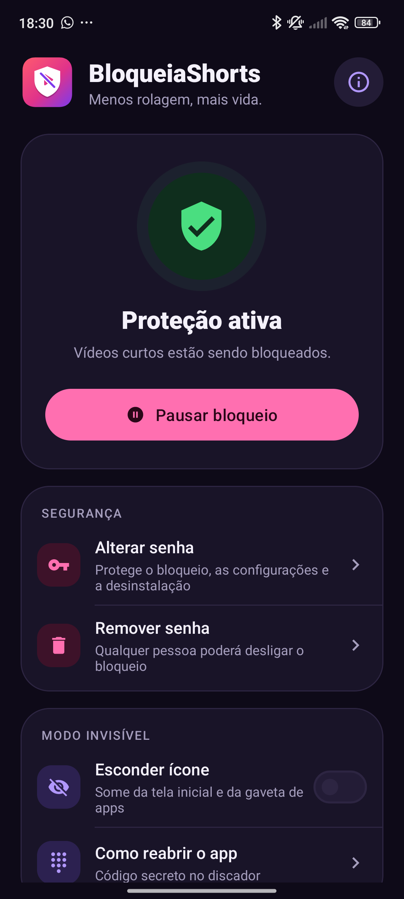

<p align="center">
  
</p>

<h1 align="center">BloqueiaShorts</h1>

<p align="center">
  <b>Menos rolagem, mais vida.</b><br>
  App Android gratuito e de código aberto que bloqueia vídeos curtos:
  YouTube Shorts, Instagram Reels, TikTok, Kwai e os mesmos vídeos abertos no navegador.
</p>

<p align="center">
  <a href="https://github.com/anddrad3/BloqueiaShorts/releases/latest"><b>⬇️ Baixar a versão mais recente</b></a>
</p>

---

## Sumário

- [O que o app faz](#o-que-o-app-faz)
- [Download](#download)
- [Instalação](#instalação)
  - [Opção A — Pelo computador (recomendada)](#opção-a--pelo-computador-recomendada)
  - [Opção B — Direto no celular](#opção-b--direto-no-celular)
  - [Resolver o aviso "Configuração restrita"](#resolver-o-aviso-configuração-restrita)
- [Primeiros passos depois de instalar](#primeiros-passos-depois-de-instalar)
- [Funcionalidades](#funcionalidades)
- [Perguntas frequentes](#perguntas-frequentes)
- [Privacidade](#privacidade)
- [Como funciona por dentro](#como-funciona-por-dentro)
- [Compilar a partir do código](#compilar-a-partir-do-código)
- [Contribuir](#contribuir)
- [Licença](#licença)

---

## O que o app faz

O BloqueiaShorts usa o serviço de **Acessibilidade** do Android para saber qual tela está aberta.
Quando aparece um vídeo curto, ele age sozinho:

| Onde | O que acontece |
|---|---|
| **YouTube Shorts** (app do YouTube) | Aperta "voltar" assim que o player de Shorts abre |
| **Instagram Reels** | Aperta "voltar" ao abrir o player de Reels |
| **TikTok, TikTok Lite, Kwai, Douyin, Kuaishou** | Vai direto para a tela inicial — o app inteiro é bloqueado |
| **No navegador** (Chrome, Firefox, Samsung Internet, Edge, Brave, Opera, DuckDuckGo, navegador da Mi) | Aperta "voltar" ao abrir links de `youtube.com/shorts`, `instagram.com/reels`, `tiktok.com` e `kwai.com` |

Vídeos normais do YouTube **não** são bloqueados — só o formato curto.

> **Testado em:** Redmi Note 11S, Android 13 (MIUI 14) — YouTube Shorts no app e no Chrome.
> Os demais apps e navegadores foram configurados, mas ainda não testados em aparelho.
> Encontrou algo que não bloqueia? [Abra uma issue](https://github.com/anddrad3/BloqueiaShorts/issues).

---

## Download

Na página de [**Releases**](https://github.com/anddrad3/BloqueiaShorts/releases/latest) há dois arquivos:

| Arquivo | Para quê |
|---|---|
| **`BloqueiaShorts-Instalador-PC.zip`** | Instalador automático pelo computador (Windows, Mac e Linux) + o app. **Recomendado.** |
| **`BloqueiaShorts.apk`** | Só o app, para instalar direto no celular. |

Requisitos: **Android 7.0 ou mais novo**.

---

## Instalação

### Por que existem duas opções?

A partir do **Android 13**, apps instalados por fora de uma loja (pelo navegador, WhatsApp, Telegram…)
ficam com a Acessibilidade bloqueada pelo aviso **"Configuração restrita"**. Na maioria dos celulares
dá para liberar em poucos toques, mas **algumas versões da Xiaomi escondem a opção de liberar**.

Instalando **pelo computador**, esse aviso **não aparece**, em qualquer celular.
Por isso a Opção A é a recomendada.

### Opção A — Pelo computador (recomendada)

Você vai precisar de um computador com internet e do celular na mesma rede Wi-Fi (ou de um cabo USB que transfira dados).

**1. No celular, ative as Opções do desenvolvedor** (só uma vez):

1. Abra **Configurações → Sobre o telefone**.
2. Toque **7 vezes** em **"Número da versão"**
   (Xiaomi: **"Versão MIUI"** ou **"Versão do HyperOS"**; Samsung: *Informações do software → Número de compilação*).
3. Vai aparecer *"Você agora é um desenvolvedor"*.

**2. Ligue as opções necessárias** em **Configurações → Opções do desenvolvedor**
(Xiaomi: *Configurações adicionais → Opções do desenvolvedor*):

- **Wi-Fi:** ligue **"Depuração por Wi-Fi"** (Android 11 ou mais novo), **ou**
- **Cabo:** ligue **"Depuração USB"**.
- **Xiaomi / Redmi / Poco:** ligue também **"Instalar via USB"**.
  A Xiaomi exige estar logado na conta Mi e ter um chip no celular (às vezes com dados móveis ligados por um instante).

**3. No computador:**

1. Baixe e **extraia** o `BloqueiaShorts-Instalador-PC.zip`.
2. Rode o instalador:
   - **Windows:** dois cliques em **`Instalar-Windows.bat`**.
     Se o Windows mostrar *"O Windows protegeu o computador"*, clique em **Mais informações → Executar assim mesmo**.
   - **Mac / Linux:** abra o Terminal na pasta e rode `bash instalar-mac-linux.sh`.
3. O instalador baixa sozinho a ferramenta oficial do Google (**adb**, ~7 MB) e pergunta como o celular vai se conectar:
   - **`1` — Cabo USB:** conecte o cabo e aceite **"Permitir depuração USB?"** no celular.
   - **`2` — Wi-Fi:**
     1. No celular, toque no **nome** "Depuração por Wi-Fi" → **"Parear dispositivo com código de pareamento"**.
     2. Aparece uma janelinha com um **código de 6 números**. **Deixe-a aberta.**
     3. Digite **só os 6 números** no instalador. O resto ele encontra sozinho na rede.
4. O instalador instala o app e o abre no celular.
   **Na Xiaomi, fique de olho no celular:** se aparecer um aviso de instalação, toque em **Instalar** (ele some em poucos segundos).
5. Pronto! Siga os [primeiros passos](#primeiros-passos-depois-de-instalar).

Depois de instalar, você pode desligar a Depuração USB / Wi-Fi — ela só é necessária para instalar.

<details>
<summary><b>Problemas com o instalador</b></summary>

| Mensagem | Solução |
|---|---|
| `INSTALL_FAILED_USER_RESTRICTED` | Xiaomi: ligue **"Instalar via USB"** e aceite o aviso no celular durante a instalação. |
| `Pareamento falhou` | A janelinha do código fechou ou o código mudou. Abra de novo e rode o instalador outra vez. |
| `Nao encontrei a janelinha automaticamente` | Digite o **"Endereço IP e porta" que aparece NA JANELINHA do código** (não o da tela anterior). |
| `more than one device` | Já corrigido na versão atual do instalador — baixe o ZIP mais recente. |
| Não conecta pelo Wi-Fi | Confirme que celular e computador estão na **mesma rede** e que a "Depuração por Wi-Fi" está ligada. |
| Cabo não é reconhecido | Muitos cabos só carregam. Use o Wi-Fi ou outro cabo. |

</details>

### Opção B — Direto no celular

1. Baixe o **`BloqueiaShorts.apk`** no celular (ou receba pelo WhatsApp/Telegram).
2. Abra o arquivo e toque em **Instalar**. Se o Android pedir, permita **"Instalar apps desconhecidos"** para o app de onde você abriu o arquivo.
   Se o **Play Protect** avisar, toque em **Mais detalhes → Instalar mesmo assim**.
3. Abra o BloqueiaShorts → **Abrir Acessibilidade** → **Apps baixados** → **BloqueiaShorts** → ligue a chave.
4. No Android 13 ou mais novo vai aparecer **"Configuração restrita"**. Veja abaixo como liberar.

### Resolver o aviso "Configuração restrita"

> O app também mostra estas instruções: na tela principal, toque em **"Apareceu 'Configuração restrita'?"**.

Em todos os casos, **tente ligar o BloqueiaShorts em Acessibilidade uma vez antes** (o aviso precisa aparecer pelo menos uma vez).

**Samsung, Motorola, Pixel e a maioria dos celulares**
1. Segure o ícone do BloqueiaShorts → **Informações do app**.
2. Toque nos **⋮** (canto superior direito) → **"Permitir configurações restritas"** → confirme.
3. Volte em Acessibilidade e ligue a chave.

**Xiaomi / Redmi / Poco — tente primeiro**
1. Segure o ícone → **Informações do app** (abre a tela da Xiaomi).
2. Toque nos **⋮** → **"Informações do app"** (abre a tela original do Android).
3. Nessa tela, toque nos **⋮** de novo → **"Permitir configurações restritas"**.

**Xiaomi sem essa opção** (algumas versões da MIUI/HyperOS escondem): use a **[Opção A](#opção-a--pelo-computador-recomendada)** ou, sem computador, o caminho **Shizuku + SAI**:

<details>
<summary><b>Passo a passo: Shizuku + SAI (sem computador)</b></summary>

O Shizuku usa a Depuração por Wi-Fi do próprio celular para instalar o app do mesmo jeito que um computador faria — sem a trava.

1. Instale pela Play Store: **Shizuku** e **SAI (Split APKs Installer)**.
2. Ative as [Opções do desenvolvedor](#opção-a--pelo-computador-recomendada) e ligue **"Depuração por Wi-Fi"**. Na Xiaomi, ligue também **"Instalar via USB"**.
3. Abra o **Shizuku** → em *"Iniciar via depuração sem fio"*, toque em **Parear**. O Shizuku cria uma **notificação** pedindo um código.
4. Vá em **Opções do desenvolvedor → Depuração por Wi-Fi → Parear dispositivo com código de pareamento**.
5. Sem fechar essa tela, puxe a barra de notificações e **digite o código na notificação do Shizuku**.
6. Volte ao Shizuku e toque em **Iniciar**. Deve aparecer *"Shizuku está em execução"*.
7. Abra o **SAI** → ⚙️ **Configurações → Instalador** → escolha **Shizuku** → permita.
8. **Desinstale** o BloqueiaShorts (se já estiver instalado).
9. No SAI: **Instalar APKs → Seletor de arquivos interno** → escolha o `BloqueiaShorts.apk`.
10. Abra o BloqueiaShorts e ligue em Acessibilidade. Agora sem o aviso.

Depois disso, o Shizuku e o SAI podem ser desinstalados.

</details>

---

## Primeiros passos depois de instalar

1. **Ative o serviço:** no app, toque em **Abrir Acessibilidade → Apps baixados → BloqueiaShorts** → ligue a chave → **Permitir**.
   A tela principal deve mostrar **"Proteção ativa"** em verde.
2. **Evite que o sistema desligue o app** (importante em Xiaomi, Samsung, Motorola, Huawei):
   segure o ícone → **Informações do app** →
   - **Inicialização automática** → ligada (Xiaomi);
   - **Bateria / Economia de bateria** → **Sem restrições**.
3. **(Opcional) Defina uma senha** em **Segurança → Definir senha** — e **anote-a**.
4. **Teste:** abra um Short no YouTube. O app deve voltar sozinho em menos de 1 segundo.

---

## Funcionalidades

### 🔒 Senha
Opcional, só números (mínimo 4). Com senha, é preciso digitá-la para **pausar/ativar o bloqueio**,
**esconder o ícone**, **trocar** ou **remover a senha**. Depois de 5 senhas erradas seguidas, o app espera 1 minuto.
A senha fica salva apenas como *hash* (embaralhada) no próprio celular.

### 🛡️ Proteção contra desligar
Com senha definida e bloqueio ativo, o app **tira você das telas do sistema** onde daria para desligá-lo ou
desinstalá-lo (Acessibilidade, informações do app, desinstalação). Assim a senha não pode ser driblada.

**Precisa mexer nessas telas?** Toque em **Pausar bloqueio** e digite a senha: a proteção desliga junto.
Ao ativar de novo, ela volta.

### 👻 Modo invisível
Esconde o ícone do BloqueiaShorts da tela inicial e da gaveta de apps. **O bloqueio continua funcionando.**

**Para reabrir o app escondido**, abra o **app de Telefone** e digite:

```
*#*#SUASENHA#*#*
```

Exemplo: senha `2580` → digite `*#*#2580#*#*`. O app abre na hora, já desbloqueado.
Não faz ligação e não aparece no histórico. Se você trocar a senha, o código muda junto.
Use **"Copiar código de reabertura"** no app para copiar o código pronto e colar no discador.

Remover a senha mostra o ícone de novo automaticamente.

### 🎨 Visual
Material 3 com modo claro e escuro automáticos, animações suaves e uma tela **"Como o app funciona"** (botão ⓘ).

---

## Perguntas frequentes

<details>
<summary><b>Se eu reiniciar o celular ou a bateria acabar, continua funcionando?</b></summary>

Sim. O serviço de Acessibilidade volta sozinho quando o celular liga, e a senha/configurações ficam salvas.
Na Xiaomi, deixe a **Inicialização automática** ligada e a bateria em **Sem restrições**.
Se mesmo assim parar, desligue e ligue o BloqueiaShorts em Acessibilidade (pause o bloqueio antes, se tiver senha).
</details>

<details>
<summary><b>Parou de bloquear. O que faço?</b></summary>

1. Abra o app: se aparecer **"Quase lá"**, o serviço foi desligado — ative de novo em Acessibilidade.
2. Confira a bateria em **Sem restrições** e a **Inicialização automática** (Xiaomi).
3. Se o serviço está ativo mas o YouTube passou a mostrar Shorts, o YouTube pode ter mudado a tela.
   [Abra uma issue](https://github.com/anddrad3/BloqueiaShorts/issues) informando a versão do YouTube.
</details>

<details>
<summary><b>Esqueci a senha. E agora?</b></summary>

- **Pelo computador:** com a depuração ligada, rode `adb uninstall com.bloqueiashorts` e instale de novo.
- **Pelo celular:** reinicie em **modo de segurança** (segure o botão de desligar e depois segure "Desligar").
  Nesse modo o app não roda; vá em Configurações → Apps → BloqueiaShorts → **Desinstalar** (ou Limpar dados).
</details>

<details>
<summary><b>Por que o app precisa de Acessibilidade?</b></summary>

É a única forma de um app saber que um vídeo curto abriu dentro de outro app e apertar "voltar" por você.
O BloqueiaShorts só observa os apps da lista de bloqueio, as telas do sistema protegidas pela senha e o
discador (apenas para reconhecer o código `*#*#...#*#*`). Nada é salvo nem enviado.
</details>

<details>
<summary><b>O app pede alguma permissão?</b></summary>

Nenhuma permissão de internet, contatos, localização, câmera ou armazenamento.
Ele **nem tem acesso à internet** — é impossível enviar dados para fora.
</details>

<details>
<summary><b>Dá para bloquear só alguns apps, ou liberar Shorts por um tempo?</b></summary>

Ainda não. Por enquanto existe o botão **Pausar bloqueio** (com senha). Sugestões são bem-vindas nas
[issues](https://github.com/anddrad3/BloqueiaShorts/issues).
</details>

<details>
<summary><b>Funciona no Android 15 ou 16?</b></summary>

O app sim. No Android 15+ o Google deixou a "Configuração restrita" mais rígida; se não conseguir liberar
pelo celular, use a [instalação pelo computador](#opção-a--pelo-computador-recomendada).
</details>

<details>
<summary><b>Por que não está na Play Store?</b></summary>

Publicar na Play Store custa US$ 25 e o Google é muito rigoroso com apps que usam Acessibilidade.
Por enquanto a distribuição é gratuita, aqui pelo GitHub.
</details>

---

## Privacidade

- ❌ Sem internet (o app nem declara a permissão).
- ❌ Sem anúncios, rastreadores ou análise de uso.
- ❌ Nenhum dado salvo além das suas configurações (bloqueio ligado/desligado e o *hash* da senha).
- ✅ Código 100% aberto — você pode conferir tudo neste repositório.

---

## Como funciona por dentro

| Arquivo | Função |
|---|---|
| [`Rules.kt`](app/src/main/java/com/bloqueiashorts/Rules.kt) | **Tudo o que é bloqueado**: IDs das telas de vídeo curto, apps bloqueados inteiros, navegadores e padrões de endereço. |
| [`ShortsBlockerService.kt`](app/src/main/java/com/bloqueiashorts/ShortsBlockerService.kt) | O serviço de Acessibilidade: detecta o vídeo curto e age; protege as configurações; lê o código do discador. |
| [`MainActivity.kt`](app/src/main/java/com/bloqueiashorts/MainActivity.kt) | A tela do app (status, senha, modo invisível, ajudas). |
| [`Prefs.kt`](app/src/main/java/com/bloqueiashorts/Prefs.kt) | Configurações salvas e a senha (SHA-256 com *salt*). |
| [`IconHider.kt`](app/src/main/java/com/bloqueiashorts/IconHider.kt) | Esconde/mostra o ícone ligando e desligando um `activity-alias`. |
| [`accessibility_service_config.xml`](app/src/main/res/xml/accessibility_service_config.xml) | Lista de apps que o serviço observa. |
| [`distribuicao/`](distribuicao) | Instaladores pelo computador (`.bat` e `.sh`). |

**Detecção:**
- **Player dentro de apps (YouTube, Instagram):** procura views com IDs específicos (ex.: `reel_recycler`)
  que ocupem pelo menos 60% da altura da tela — miniaturas de Shorts no feed são ignoradas.
- **Navegadores:** lê o texto da barra de endereço (pelo ID conhecido ou procurando no topo da tela) e compara com uma expressão regular.
- **Robustez:** se o "voltar" não fechar o vídeo, tenta de novo a cada ~0,9 s; após 3 tentativas, vai para a tela inicial.
  Uma verificação periódica pega vídeos que ficam tocando sem gerar eventos.

---

## Compilar a partir do código

Requisitos: **JDK 17** e **Android SDK** (plataforma 35) — o jeito mais fácil é instalar o [Android Studio](https://developer.android.com/studio).

```bash
git clone https://github.com/anddrad3/BloqueiaShorts.git
cd BloqueiaShorts
./gradlew assembleRelease        # Windows: gradlew assembleRelease
```

O APK sai em `app/build/outputs/apk/release/app-release.apk`.

**Assinatura:** o build procura a chave oficial em `~/.bloqueiashorts/keystore.properties`
(`storeFile`, `storePassword`, `keyAlias`, `keyPassword`). Sem esse arquivo, o release é assinado com a chave
de depuração — funciona normalmente, mas não atualiza por cima da versão oficial.

**Pacote de distribuição:** copie o APK como `BloqueiaShorts.apk` para junto dos arquivos de
[`distribuicao/`](distribuicao) e compacte tudo em `BloqueiaShorts-Instalador-PC.zip`.

> Se a pasta do projeto tiver acentos (ex.: "Área de Trabalho"), o `gradle.properties` já inclui
> `android.overridePathCheck=true` para o build funcionar no Windows.

---

## Contribuir

Contribuições são muito bem-vindas! Ideias:

- **O YouTube/Instagram mudou e parou de bloquear?** Descubra os novos IDs das views
  (Android Studio → *Layout Inspector*, ou `adb shell uiautomator dump`) e atualize [`Rules.kt`](app/src/main/java/com/bloqueiashorts/Rules.kt).
- **Testou em outro celular/app?** Conte nas [issues](https://github.com/anddrad3/BloqueiaShorts/issues) o que funcionou.
- **Novos apps** (Facebook Reels, Pinterest, Snapchat Spotlight…), horários de bloqueio, estatísticas.

Ao adicionar um app novo em `Rules.kt`, inclua o pacote também em `accessibility_service_config.xml`.

---

## Licença

Distribuído sob a **GNU General Public License v3.0** — veja [`LICENSE`](LICENSE).
Você pode usar, estudar, modificar e redistribuir, desde que versões modificadas também sejam abertas sob a GPL-3.0.

*YouTube, Instagram, TikTok e Kwai são marcas de seus respectivos donos. Este projeto não tem relação com essas empresas.*
